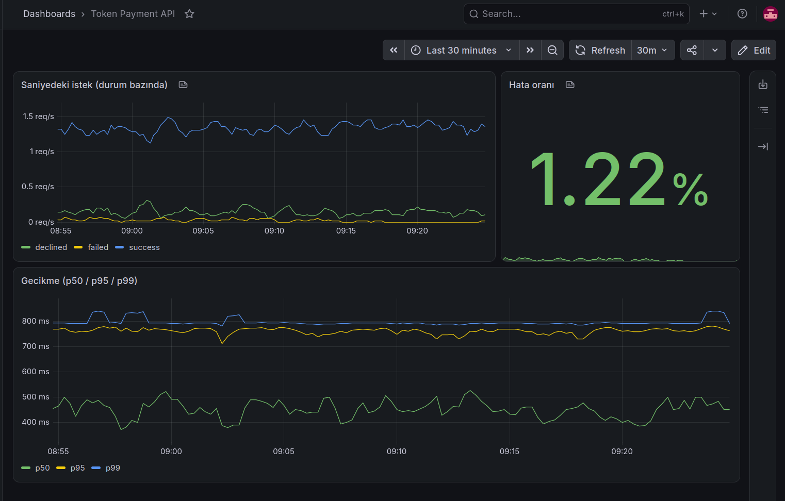
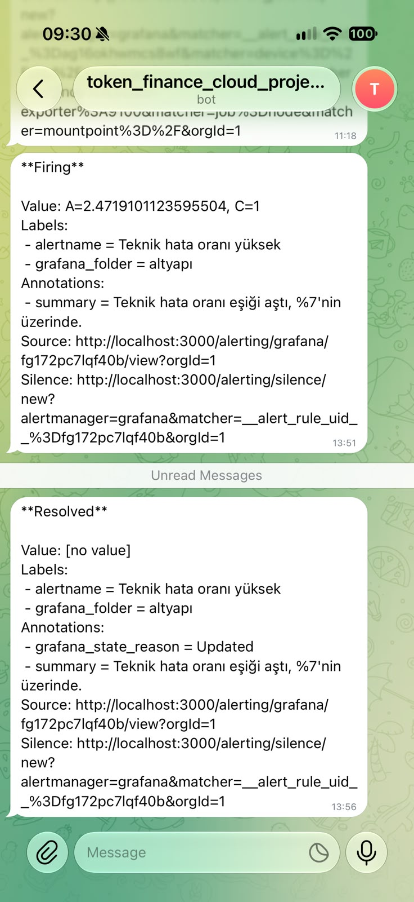
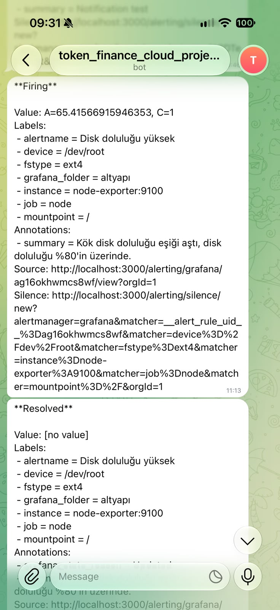

# GCP Üzerinde Ödeme API'si: DevOps / SRE Portfolyo Projesi

Bu proje, Go ile yazılmış ve Google Cloud üzerinde çalışan küçük bir ödeme API'sidir. API'nin kendisi basit. Projenin odağı onun etrafındaki her şey: container'laştırma, CI/CD, monitoring, alarm ve güvenlik. Bu sunucuda yaşanan gerçek bir olayı ve nasıl çözdüğümü de anlatıyorum.

## Mimari

```
  git push
     │
     ▼
 GitHub Actions ──► build ──► Trivy taraması ──► Docker Hub ──► deploy (SSH)
                                   │                                 │
                  (HIGH/CRITICAL açık varsa burada durur)            ▼
                                                    ┌───── GCP VM (Ubuntu 24.04) ─────┐
                                                    │  Docker ağı: "monitoring"       │
                                                    │                                 │
                                                    │  payment-api ◄── load-gen       │
                                                    │       │                         │
                                                    │       ▼ /metrics                │
                                                    │  Prometheus ◄── node-exporter   │
                                                    │       │                         │
                                                    │       ▼                         │
                                                    │    Grafana ──► Telegram alarm   │
                                                    └─────────────────────────────────┘
```

- **payment-api:** Go servisi. Her istek 100–800 ms arası rastgele bekler ve üç sonuçtan birini döner: başarılı, reddedildi (HTTP 402) veya teknik hata (HTTP 504).
- **load-gen:** Sürekli istek gönderen küçük bir container. Dashboard'lar her zaman canlı veri gösterir.
- **Prometheus:** API'den ve node-exporter'dan her 5 saniyede bir metrik toplar.
- **node-exporter:** Sunucu metriklerini toplar (disk, RAM, CPU).
- **Grafana:** Dashboard'lar ve alarm kuralları daha sonra alarmlar Telegram'a gönderilir.

Tüm container'lar aynı Docker ağında. İsimlerle haberleşiyorlar. (örneğin `payment-api:9093`).

## Kullanılan Teknolojiler

- **Dil:** Go
- **Container:** Docker (multi-stage build, distroless imaj)
- **Bulut:** Google Cloud Compute Engine (e2-micro), statik dış IP, VPC firewall kuralları
- **CI/CD:** GitHub Actions, Docker Hub
- **Güvenlik taraması:** Trivy
- **Monitoring:** Prometheus, node-exporter, Grafana
- **Alarm:** Grafana alerting + Telegram botu

## CI/CD Pipeline

`main` branch'ine yapılan her push iki iş çalıştırır:

**1. build-and-push**

1. Docker imajını build et NOT: Build ilk başta github'da tutulur direkt gönderilmez.
2. İmajı Trivy ile `HIGH` ve `CRITICAL` açıklar için tarar ve eğer ki açık bulunursa pipeline burada durur.
3. Güvenlik açığı yoksa imaj Docker Hub'a gönderilir. Hangi imajın hangi committen olduğunun anlaşılması için tag commit sha'sıdır.

**2. deploy** (sadece ilk iş başarılı olursa çalışır)

1. VM'e SSH ile bağlanır. Sadece bu iş için oluşturulmuş bir deploy anahtarı ve kullanıcı kullanılır.
2. Yeni imajı çeker, çalışan container'ı değiştirir ve başlatır.
3. Health check: 5 saniye sonra `/metrics`'in cevap verdiğini kontrol etmeyi sağlar. Uygulama açılmazsa pipeline başarısız olur.

Bu sıralama sayesinde bilinen HIGH/CRITICAL açığı olan bir imaj ne yayınlanır ne de deploy edilir.

## Monitoring ve Alarm

**Uygulama metrikleri**

- `request_status_counter{status}`: Sonuca göre istek sayısı (`success`, `declined`, `failed`).
- `payment_request_duration_seconds{status}`: İstek süresi, **histogram** olarak.

Gecikme için histogram kullanıyorum, çünkü ortalama yavaş istekleri gizlediğini araştırdım. Örneğin 99 istek 100 ms, 1 istek 10 saniye sürerse ortalama yine iyi görünür. Yüzdelikler (p95, p99) en yavaş kullanıcıların gerçekte ne yaşadığını gösterir. Histogram bucket'ları (0.1–1 sn) bu API'nin beklenen gecikme aralığına göre seçildi.

**Dashboard panelleri**

- Saniyedeki istek sayısı, sonuca göre
- Teknik hata oranı (%)
- Gecikme: p50 / p95 / p99

dashboardların gösterdiği metrikler bunlardır.



**Alarmlar (Telegram'a gönderilir)**

| Alarm                    | Koşul                              | Neden bu eşik?                                                                                                                     |
| ------------------------ | ---------------------------------- | ---------------------------------------------------------------------------------------------------------------------------------- |
| Disk doluluğu yüksek     | Kök disk 5 dk boyunca > %80        | Erken uyarı. %100'de iş işten geçmiş olur (aşağıdaki olaya bak).                                                                   |
| Teknik hata oranı yüksek | 5 dk'lık pencerede hata oranı > %7 | Normal hata oranı ~%2 ve küçük örneklemde %5'e kadar dalgalanıyor. %7 bu normal gürültünün üstünde, böylece alarm boş yere çalmaz. |

Reddedilen ödemeler **hata olarak sayılmaz.** Bir ret (örneğin yetersiz bakiye) sistemin doğru çalıştığını gösterir. Bu teknik bir arıza değil, bir iş metriğidir. Sadece teknik hatalar (HTTP 504) alarmı tetikler.

İki alarm da uçtan uca test edildi: Eşiği düşürdüm, Telegram mesajını gördüm, sonra eşiği geri aldım ve "Resolved" mesajını aldım.

<p>
  
  
</p>

## Güvenlik

- **Küçük imaj:** Multi-stage build. Go ilk aşamada derleniyor ve sadece binary distroless imaja kopyalanıyor. İmaj **~1.5 GB'tan ~5 MB'a** indi (sıkıştırılmış). İçinde shell ve paket yöneticisi yok, saldırı yüzeyi küçük.
- **Non-root:** Container `nonroot` kullanıcısıyla çalışıyor.
- **Açık taraması:** Trivy, Go standart kütüphanesinde 3 HIGH CVE buldu (Go 1.27.1, hepsi `net/http` ve `crypto/tls`'te Denial of Service). Go standart kütüphanesi binary'nin içine derlenir, yani temiz bir base imaj tek başına yetmez. Builder imajını Go 1.27.2'ye yükselterek düzelttim.
- **Firewall:** İnternete sadece 22 (SSH) ve 3000 (Grafana, şifre korumalı) portları açık. RDP (3389) dahil kullanılmayan kuralları kaldırdım.
- **Defense in Depth:** Prometheus (9090) ve API (9093) Docker'da da `127.0.0.1`'e bağlı. Yani bir firewall kuralı yanlışlıkla açılsa bile bu portlara dışarıdan erişilemez. node-exporter hiç port yayınlamıyor.
- **Secrets:** Docker Hub erişim token'ı, SSH deploy anahtarı ve VM bilgileri GitHub Actions secrets'ta saklanıyor. Deploy anahtarı sadece CI/CD için ayrı bir anahtar. Benim kendi erişimimi etkilemeden iptal edilebilir.
- **Supply Chain:** Mart 2026'da `trivy-action`'ın sürüm etiketlerinin çoğu ele geçirildi. Bu proje olaydan sonra yayınlanan bir sürümü kullanıyor.

## Olay ve Çıkarılan Dersler

Sunucunun 10 GB'lık diski %100 doldu. Bu yüzden SSH anahtarı sunucuya yazılamadı ve bağlanamadım. Docker da başlatılamadı. Sorunu serial port loglarından buldum, diski bir kurtarma VM'ine takıp 20 GB'a genişlettim.

Kök neden Docker imajlarıydı: Uygulama imajı multi-stage olmadan build edildiği için 1.5 GB'tı, kullanılmayan bir `golang` imajı da 1.3 GB yer kaplıyordu. Düzeltmeden sonra multi-stage build, log boyutu limitleri, Prometheus saklama limiti, swap ve disk alarmı ekledim. Bu diski çok daha efektif ve kaliteli kullanmamı sağladı.

Postmortem'in tamamı: [POSTMORTEM.md](POSTMORTEM.md)

## Altyapı Detayları

- GCP e2-micro (2 paylaşımlı vCPU, 1 GB RAM), Ubuntu 24.04, 20 GB disk, 2 GB swap
- Container logları 10 MB × 3 dosya ile sınırlı
- Prometheus verisi kalıcı bir volume'da, 1 GB ile sınırlı
- Tüm container'lar `--restart unless-stopped` ile çalışıyor

## Bilinen Eksikler ve Sonraki Adımlar

- **Ayarlanabilir hata enjeksiyonu:** Hata oranını ortam değişkeniyle (`ERROR_RATE`) ayarlanabilir yapmak. Bu, canlı demo imkanı verir: hata oranını artırıp alarmın Telegram'a düştüğünü göstermek.
- **GitHub Actions'ı commit SHA ile sabitlemek:** trivy-action olayındaki gibi tedarik zinciri saldırılarına karşı etiket yerine SHA kullanmak.
- **Docker verisi için ayrı disk:** `/var/lib/docker`'ı kendi diskine taşımak. Böylece dolan bir Docker diski işletim sistemini durduramaz (daha küçük blast radius).
- **Nginx reverse proxy + HTTPS:** Grafana ve API'nin önüne.
- **Docker Compose:** Tüm `docker run` komutlarını tek bir `docker-compose.yml` dosyasında toplamak.
- **Kubernetes:** Deployment / Service / ConfigMap manifest'leri yazmak. Mevcut 1 GB'lık VM, Kubernetes ile monitoring'i birlikte kaldırmak için çok küçük.
- **Yük testi:** k6 ile bu kurulumun saniyede en fazla kaç isteği kaldırabildiğini bulmak ve kısa bir kapasite notu yazmak.
